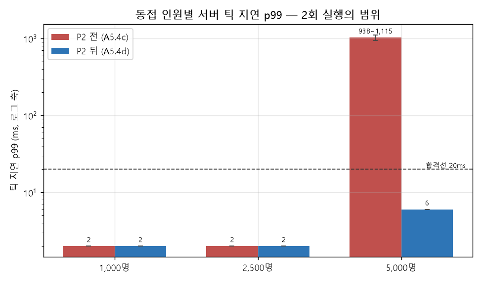
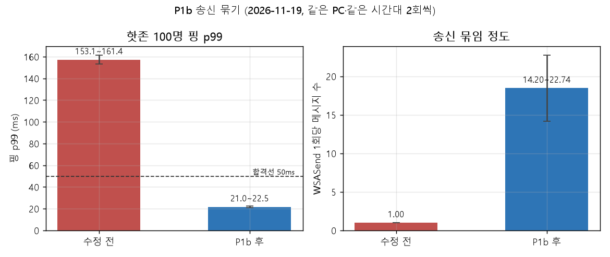
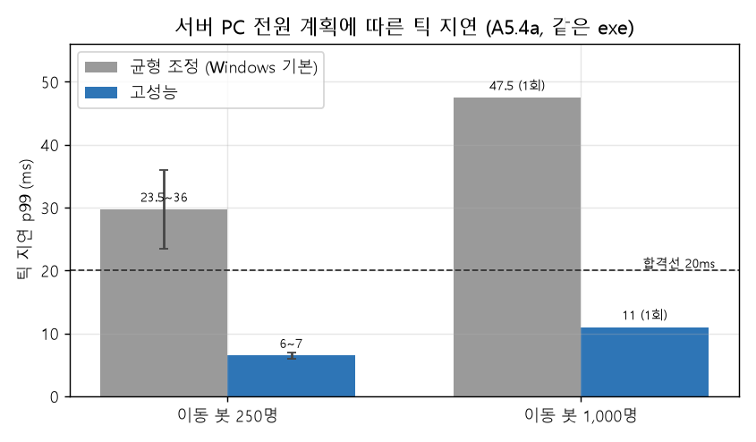
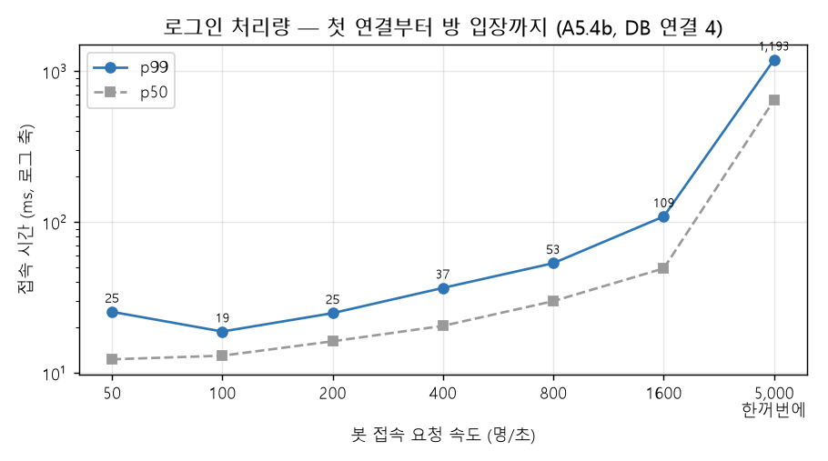
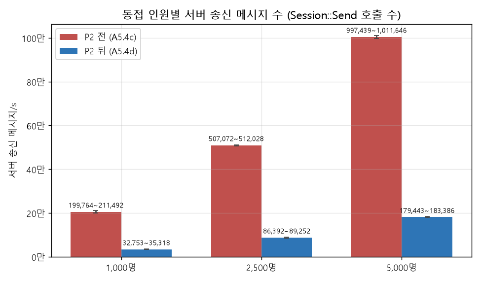
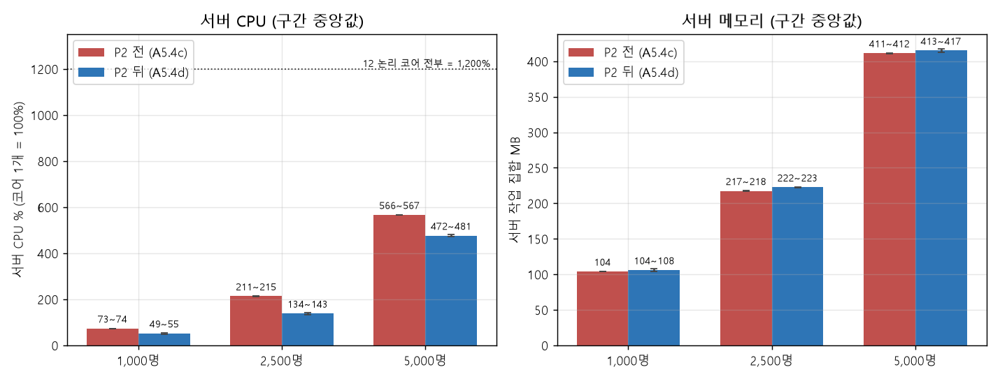
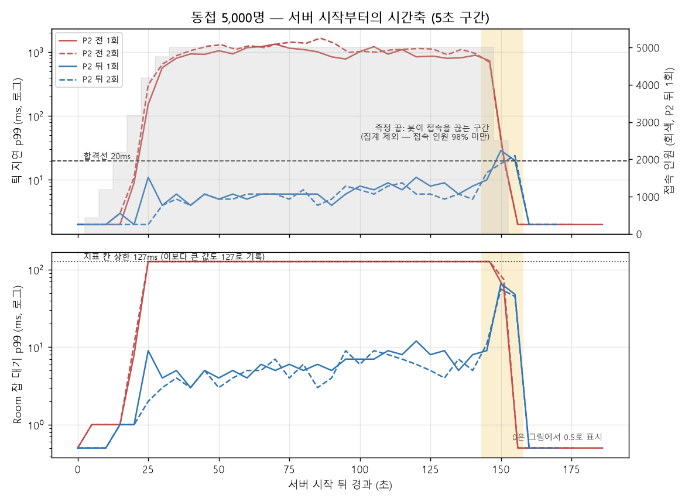

# 동접 부하 벤치마크 보고서

JH_MMO 게임 서버(IOCP C++)가 동시 접속 5,000명을 어떻게 처리하게 되었는지를 측정 환경, 방법, 결과, 개선 과정 순서로 정리한 보고서입니다(ROADMAP A7.2, 2026-11-24).
- 모든 숫자는 저장소에 커밋된 원자료(`Server/PerfData/`, `Tools/BotPack/results/`)에서 다시 뽑았습니다.
- 그래프와 표는 `Tools/Benchmark/make_figures.py`로 다시 만들 수 있습니다.
- 2026-11-19 이전 구간은 원자료가 남아 있지 않아 당시 문서의 수치만 인용했고, 그 사실을 표마다 적었습니다.
- 숫자와 논리는 다른 모델(Claude Fable) 에이전트가 원자료와 독립적으로 대조했습니다.

---

## 1. 요약

**동접 5,000명 서버 합격 — 틱 지연 p99 6ms** (2026-11-24, 2회 모두. 합격 기준 20ms)

### "서버 합격"의 조건
- **서버 지표가 합격선 안**
  - 틱 지연 p99와 Room 잡 대기
  - 접속 실패 0, 서버 로그 WARN·ERROR 0, 끝난 뒤 DB 정합 검사 오류 0
- **클라이언트 핑은 판정에서 뺐습니다(D-305).**
  - 노트북 봇의 핑 p99는 부하가 거의 없는 20명에서도 70ms였습니다. 이 측정 구성(Wi-Fi)으로는 50ms 합격선을 판정할 수 없습니다.
  - 5,000명에서 노트북 봇 핑 p99는 106~168ms였습니다.
  - 서버 PC에서 같이 돌린 봇의 핑 p99는 19.0~20.9ms였지만, 이것은 루프백 값입니다.
  - 노트북 쪽 봇 수가 같은데도 2,500명 → 5,000명에서 노트북 핑 p50이 약 31 → 약 70ms로 늘었습니다. 원인은 가르지 못했습니다(§6).
- **CPU 합격선(70%)은 12 논리 코어 대비로 봤습니다.**
  - 서버 472~481%(코어 1개 = 100%)는 1,200%의 약 40%입니다.
  - 다만 IOCP 워커는 6개이고, P2 전 5,000명에서 서버 CPU가 약 567%에 평평하게 붙어 있었습니다(포화로 보임). 지금 값은 그 포화 수준의 약 85%입니다.
  - 5,000명을 넘는 인원은 재지 않았습니다(§6).

### 결과 요약 표
| 동접 | 틱 지연 p99 (P2 전 → 후) | 서버 송신 메시지/s (전 → 후) | 서버 CPU (전 → 후) | 서버 메모리 (전 → 후) | 판정 (P2 뒤) |
|---|---|---|---|---|---|
| 1,000 | 2 → 2ms | 20.0만~21.1만 → 3.3만~3.5만 | 73~74% → 49~55% | 104 → 104~108MB | 합격 |
| 2,500 | 2 → 2ms | 50.7만~51.2만 → 8.6만~8.9만 | 211~215% → 134~143% | 217~218 → 222~223MB | 합격 |
| 5,000 | **938~1,115 → 6ms** | **99.7만~101.2만 → 17.9만~18.3만** | 566~567% → 472~481% | 411~412 → 413~417MB | **합격** |

- **P2** = 이동 패킷 묶기(D-307). 다른 캐릭터의 이동을 33ms마다 수신자별 패킷 하나로 묶어 보냅니다(§4-6).
- **값의 뜻**: 각 칸은 2회 실행의 범위입니다. 실행마다 "접속 인원이 목표의 98% 이상인 5초 구간" 값의 중앙값을 냈습니다(§3-4).
- **전/후 비교의 조건**: 같은 구성(노트북 + 서버 PC)에서 P2 전 exe와 P2 뒤 exe로 약 2시간 간격을 두고 쟀습니다. 같은 exe에서 설정만 바꾼 A/B는 2,500명까지 했습니다(§4-6).
- **핫존 재측정**: 판정 범위인 핫존(한 화면에 몰린 인원, D-210)도 P2 뒤 다시 쟀고, 50명·100명 모두 합격했습니다(§5-3).

---

## 2. 측정 환경

### 2-1. 서버 PC (서버 + 일부 봇)
| 항목 | 값 |
|---|---|
| CPU | Intel Core i5-10400F 2.9GHz, 6코어 12스레드 |
| 메모리 | 32GB DDR4-2667 |
| 저장장치 | Samsung 970 NVMe SSD |
| OS | Windows 11 Pro (10.0.26200) |
| 네트워크 | 유선 이더넷 1Gbps |
| 전원 계획 | 측정 동안 "고성능", 끝나면 "균형 조정"으로 되돌림(실행 스크립트가 처리, D-303) |
| DB | SQL Server 2025 Express(17.0.1000.7), ODBC Driver 17, 같은 PC, 연결 4개 |
| 빌드 | Release x64. 아래 "빌드 커밋" 참고 |

**빌드 커밋**
- **A5.4c(P2 전)**: 측정 시각(07:27~07:47)의 마지막 서버 코드 커밋은 `e62b85c0`입니다. 다만 exe가 그 뒤 덮어써져 exe 자체로는 확인할 수 없습니다.
- **A5.4d(P2 뒤)와 핫존 재측정**: 커밋 `fb2ed30d`(P2)의 코드입니다. exe 빌드 시각(08:17)과 소스 마지막 수정이 일치하는 것을 확인했습니다.

### 2-2. 노트북 (봇 전용)
| 항목 | 값 |
|---|---|
| CPU·메모리 | Intel Core i5-1135G7, 4코어 8스레드, 7.7GB |
| 네트워크 | Wi-Fi 6(802.11ax), 수신 링크 1,201Mbps(A5.4c)·961Mbps(A5.4d), 신호 87~88% (세션당 1회 기록) |
| 전원 | 충전 중. 전원 모드 "최고 성능"(전원 연결 시 오버레이) |

- 기록 파일 `env.txt`에는 전원 구성표가 "균형 조정"으로 찍혀 있습니다. 이 줄은 오버레이를 보여 주지 않기 때문입니다(`Tools/BotPack/results/status.md`).

### 2-3. 서버 설정 (`ServerConfig.ini` 사본은 실행 폴더마다 있음)
| 키 | 값 | 뜻 |
|---|---|---|
| `WorkerThreads` | 0 (자동 = 6) | IOCP 워커 수 = 논리 코어의 절반 |
| `SendFlushIntervalMs` | 10 | 세션별 송신 묶기 간격(P1b, D-206·D-207) |
| `MoveBatchMs` | 33 (A5.4c는 키 없음 = 묶지 않음) | 이동 묶음 간격(P2, D-307) |
| `TimerResolutionMs` | 1 | 서버 시작 때 `timeBeginPeriod(1)` |
| `TcpNoDelay` | false | 켜도 차이가 없었음(D-303) |
| `SendQueueLimit` / `IdleTimeoutSec` | 4000 / 60 | 받지 않는 클라이언트·유휴 연결 정리(A5.0) |
| `DummyRoom` / `DummyTownPercent` | spread / 30 | 봇의 **처음** 배치를 마을 30% : 사냥터 70%로 고르게(§3-1) |

- 맵: `Continent01`(한 변 약 500m). 시야 반경 50m + 여유 5m(`WorldTable`).
- 채널 정원 500명이고, 채널마다 마을·사냥터 Room이 하나씩 있습니다. 그래서 5,000명이면 채널 10개, Room 20개입니다.

---

## 3. 측정 방법

### 3-1. 봇
봇은 서버와 같은 프로토콜을 쓰는 헤드리스 클라이언트입니다(`Server/LoadTest`, 봇 엔진 `Server/BotEngine`).
- 서버와 같은 내비메시를 읽어 길을 따라 걷습니다.
- 사냥 봇은 `SkillTable`의 동작 시간·쿨타임·이동 잠금을 지킵니다.
- 핑은 1초마다 보내고, 이동은 200ms마다 보냅니다(한 번에 최대 300cm).

| 프로필 | 행동 |
|---|---|
| idle | 거의 서 있음. 30~90초마다 3~8초 동안 2~6m만 걸음 |
| move | 10~30m 앞 임의 지점으로 계속 걸음(도착·10초·막힘이면 새 목표) |
| chat | move처럼 걸으면서 약 15초(±50%)마다 채팅 한 줄(같은 Room 전체에 방송) |
| hunt | 가장 가까운 몬스터에게 가서 기본 공격 4 : 스킬1 1 : 스킬2 1 비율로 공격 |
| loot | hunt + 15m 안의 드랍을 주우러 감. 인벤토리가 차면 버림 |
| trade | 마을에서 다른 거래 봇에게 다가가 1:1 거래(약 20초마다) |
| auction | 경매 NPC 앞에서 약 3초마다 검색·등록·구매·취소·수령 중 하나 |

- **계정과 비율**: 단계 램프는 계정 봇(DB 계정 `bot_0`~`bot_4999`, 일반 로그인)을 썼습니다. 섞는 비율은 **idle 25 · move 15 · chat 10 · hunt 20 · loot 20 · trade 5 · auction 5**입니다(D-298). 실제 유저 분포를 측정한 값이 아니라 정한 가정값입니다.
- **마을 비율은 측정 중에 바뀝니다.**
  - 처음 배치는 마을 30 : 사냥터 70입니다. 마을에서 시작한 봇은 마을 안에서만 돌아다닙니다(`--town-wander`).
  - 그런데 측정 약 120초 동안 마을 비율이 30% → 41~43%로 계속 늘었습니다. 집계 구간의 중앙값은 39~41%이고, P2 전후가 같습니다.
  - 사냥터에서 죽은 봇이 마을에서 부활하는 것으로 추정하지만, 확인하지는 않았습니다.
  - 즉 부하는 정상 상태가 아니라 사냥터 인원이 서서히 줄어드는 중에 잰 값입니다.

### 3-2. 단계 램프 (A5.4c·A5.4d)
| 단계 | 봇 위치 | 접속 속도 | 실행 길이 |
|---|---|---|---|
| 1,000명 | 노트북 1,000 | 초당 200명 | 125초 |
| 2,500명 | 노트북 2,500 | 초당 200명 | 135초 |
| 5,000명 | 노트북 2,500 + 서버 PC 2,500 | 각 초당 100명 | 145초 |

- 단계마다 2회씩 쟀습니다. 전원이 들어온 뒤 측정 구간은 약 120초입니다.
- 5,000명은 노트북 한 대로 만들 수 없어 서버 PC에서 나머지를 돌렸습니다(D-305).
  - P2 전 2,500명에서 노트북 수신이 약 370Mbps일 때 핑이 1초 넘게 쌓였습니다.
  - Wi-Fi 한계로 추정하지만, 그때 노트북 봇 CPU도 8 논리 코어의 61~77%였습니다. 어느 쪽 한계인지는 가르지 않았습니다.

### 3-3. 지표
| 지표 | 출처 | 뜻 |
|---|---|---|
| 틱 지연 p99 | 서버 `metrics.csv` `tick_late_p99_ms` | Room 틱(100ms 주기 업데이트)이 예정 시각보다 늦게 시작한 정도. Room 잡 큐가 밀리면 커짐 |
| Room 잡 대기 p99 | `job_wait_p99_ms` | 잡이 큐에 들어간 뒤 실행되기까지 걸린 시간. 1ms 칸 히스토그램이라 **127ms가 상한**(그 이상도 127로 기록) |
| 송신 메시지/s | `messages_out_ps` | `Session::Send` 호출 수(방송은 받는 사람 수만큼 셈) |
| WSASend/s | `send_calls_ps` | 실제 송신 시스템 콜 수 |
| 서버 CPU | 실행 스크립트가 1초마다 프로세스 CPU 시간 기록 | 사용자 + 커널, 코어 1개 = 100%(12 논리 코어 전부 = 1,200%) |
| 서버 메모리 | 같은 기록의 작업 집합(MB) | |
| 봇 1명 최대 수신 | 봇 `max_bot_recv_KBps` | 5초 구간에서 가장 많이 받은 봇 1명의 KB/s |
| 핑 p99 | 봇 `loadtest.csv` | `CS_PING` → 응답 왕복. 서버에서는 Room 잡 큐를 거쳐 답하므로 Room 처리 지연이 포함됨 |
| 접속 시간 p99 | 봇 `enter_p99_ms` | 첫 TCP 연결부터 Room 입장까지 |

- 서버 송신 **바이트**는 기록하지 않았습니다. 받는 양은 봇 쪽 수신량으로만 압니다.

### 3-4. 집계와 합격선
- **집계**: 실행마다 접속 인원이 목표의 98% 이상인 5초 구간만 골라 그 값들의 중앙값(괄호 안은 최대)을 냅니다(`Server/PerfData/2026-11-24_A5.4d/summarize.py`와 같은 규칙).
- **합격선(D-057)**:
  - 틱 본문·틱 지연 p99 ≤ 20ms, 핑 p99 ≤ 50ms
  - 봇 1명 수신 ≤ 64KB/s
  - 송신 큐가 계속 늘지 않음, CPU ≤ 70%
  - 접속 실패·로그 유실 0, 메모리 안정
- **판정 범위(D-210)**: 한 화면 인원은 핫존 50명까지 판정합니다. 핫존 100명 이상은 무너지지 않는지만 보는 참고 측정입니다.

---

## 4. 개선 과정

시기마다 맵, 전원 계획, 봇 배치가 달라 **시기 사이의 절대값은 비교하지 않습니다**. 각 개선은 같은 날 잰 전/후로 비교하고, 조건이 어디까지 같은지를 함께 적습니다.

| 날짜 | 단계 | 무엇을 했나 | 전 → 후 | 비교 조건 |
|---|---|---|---|---|
| 10-31 | A1.3 기준선 | 병목 찾기(CPU 샘플링) | 핫존 100 핑 p99 202ms, 서버 CPU의 약 90%가 커널 네트워크 경로 | — |
| 11-06 | 재측정 | 워커 1개 자연 실험 | 핫존 100 핑 p99 146~173 → 37ms(워커 6 → 1) | 같은 exe, 설정만 다름 |
| 11-19 | P1b | 세션별 송신 묶기 | 핫존 100 핑 p99 153~161 → 21~23ms | 수정 전/후 exe를 이어서 측정 |
| 11-24 | A5.4a | 측정 환경 원인 확인 | 이동 250명 틱 지연 p99 23.5~40.5 → 2~7ms(전원 계획) | 같은 exe, 전원 계획만 다름 |
| 11-24 | A5.4b | 로그인 처리량 | 5,000명을 약 3초(초당 1,600명)에 넣어도 접속 시간 p99 109ms | 속도마다 1회 |
| 11-24 | A5.4c → P2 → A5.4d | 이동 패킷 묶기 | 5,000명 틱 지연 p99 938~1,115 → 6ms | P2 전/후 exe, 약 2시간 간격 (같은 exe A/B는 2,500명까지) |

### 4-1. 병목 찾기 — 수신자마다 `WSASend` (2026-10-31, A1.3)
> 원자료 없음(당시 세션 임시 폴더) — `Docs/TESTING.md` 2026-10-31 행의 수치. 맵은 지금과 다른 `ParagonSample`.

- **현상**: 한 Room에 100명을 모은 핫존에서 틱 본문은 2.6ms인데 틱 지연은 187ms, 핑 p99는 202ms였습니다.
- **원인**: CPU 샘플링(xperf) 결과 서버 CPU의 약 90%가 커널 네트워크 경로(ntoskrnl·tcpip·NETIO·afd)였고, 게임 함수는 각각 1% 미만이었습니다.
  - 이동 한 건이 시야 안 99명에게 `Send`되고, 각각 즉시 `WSASend` 시스템 콜이 **Room 잡 안에서** 실행되고 있었습니다.
  - 그래서 Room 하나의 처리가 송신 시스템 콜에 묶여 직렬 큐가 밀렸습니다.
- **함께 한 일**: 시야 계산을 큰 셀 + 쿼드트리 AOI(반경 50m)로 바꿔 시야 누락을 0으로 만들었습니다. 대신 분산 1,000명의 송신이 2.0만 → 12.4만 메시지/s로 6배 늘었습니다.
- **결론과 다음 순서**: 주 병목은 "Room 잡 안에서 수신자마다 부르는 `WSASend`"입니다. 개선 순서를 P1 송신 묶기 → P2 이동 묶기 → (P3 거리별 빈도, P4 몬스터 깨우기 범위)로 정했습니다.

### 4-2. 묶기의 근거 — 워커 1개 자연 실험 (2026-11-06)
> 원자료 없음 — `Docs/PERF_BASELINE_2026-11-06.md` 수치. 그때는 `WSASend` 호출 수 지표가 없었습니다(P1a에서 추가).

| 핫존 100 | 워커 6 (기본) | 워커 1 |
|---|---|---|
| 핑 p99 | 146~173ms (3회) | 37ms |
| 틱 지연 p99 | 147~250ms | 17ms |
| 서버 CPU (코어 1개 기준) | 70% | 16% |
| 세션 송신 큐 최대 | 1 | 76~82 |

- **해석**: 워커가 하나뿐이면 송신 완료를 기다리는 동안 세션 큐에 메시지가 쌓여 한 번에 나간 것으로 보입니다. 세션 큐 최대값과 CPU 변화로 추정한 것입니다.
- 이 결과로 "세션당 모아 보내면 송신 시스템 콜이 줄어든다"고 보고 P1을 설계했고, P1a에서 호출 수 지표를 넣어 직접 확인했습니다(§4-3).

### 4-3. P1b 송신 묶기 (2026-11-19)
- **수정**: Room 잡 안에서 부른 `Session::Send`는 바로 보내지 않고 세션 큐에 넣습니다. 마지막 송신 뒤 10ms가 지난 세션만 세션당 `WSASend` 1회로 내보냅니다(D-206·D-207).
  - 내보낼 세션이 많으면 16개씩 IOCP 워커에게 넘겨, Room 스레드가 송신 시스템 콜에 막히지 않게 했습니다.
  - 타이머 해상도를 1ms로 올려 10ms 간격이 15.6ms로 늘어지지 않게 했습니다.
- **측정**: 같은 PC·같은 오후에 수정 전 exe와 후 exe를 이어서 2회씩 쟀습니다(`Server/PerfData/2026-11-19_P1b_after/`). 이날은 전원 계획을 기록하지 않았습니다. 기본값인 균형 조정이었을 가능성이 높아, 아래 값은 그 조건의 전/후입니다.

| 핫존 100 (워커 6) | 수정 전 | P1b 후 |
|---|---|---|
| 핑 p99 | 153.1~161.4ms | **21.0~22.5ms** |
| 틱 지연 p99 | 155~163.5ms | **9.5~12.5ms** |
| `WSASend` 1회당 메시지 | 1.00 | **14.2~22.7** |
| 서버 CPU | 77~82% | 26~42% |

- 같은 날 측정 32회는 모두 실패 0이었습니다.
- **채우지 못한 것과 대가**
  - P1b 자체 목표였던 "핫존 100 서버 CPU ≤ 25%"는 채우지 못했습니다(26%·42%, D-208에서 기록용으로 내림).
  - 분산 1,000명 핑은 22~29 → 24~31ms로 그대로였습니다.
  - 워커 1개로 띄우면 수정 후가 더 나빠집니다. 운영하지 않는 설정이라 고치지 않았습니다.
  - 한산한 곳(핫존 25)의 핑이 8~9 → 12ms로 늘었습니다. 묶는 시간 10ms가 응답에 더해지기 때문이며, 클라이언트를 선반영 구조로 바꿔 체감 지연을 숨겼습니다(CP1, D-211).

### 4-4. 측정 환경의 함정 — 전원 계획 (2026-11-24, A5.4a)
- **현상**: 이동만 하는 봇 250명에서도 성능이 흔들렸습니다.
  - PL1(11-21)에서는 틱 지연 p99가 40ms로 합격선을 넘었습니다.
  - A5.1에서는 같은 인자인데 실행마다 5~15ms로 갈렸습니다.
- **원인 찾기**: 틱 지연을 타이머 늦음·큐 대기·앞 작업 수·틱당 이동 수로 나누는 지표를 넣었습니다. 그 결과 지연은 거의 전부 앞에 쌓인 이동 작업의 큐 대기였습니다.
- **원인**: Windows 전원 계획이었습니다. 같은 exe로 전원 계획만 바꿔 쟀습니다.

| 이동 봇 (사냥터 Room 틱 지연 p99) | 균형 조정 (Windows 기본) | 고성능 |
|---|---|---|
| 250명 | 23.5~40.5ms (4회) | 2~7ms (4회) |
| 1,000명 | 46.5~47.5ms (2회) | 11~14ms (2회) |

- 그래프는 `TcpNoDelay` 꺼짐(기본)만 그렸습니다. 표는 켜짐까지 포함한 범위입니다.
- 서버 CPU는 250명에서 균형 조정이 고성능의 약 2~3배(평균 2.4배, 33~56% 대 17~19%), 1,000명에서 약 1.3배였습니다. `TCP_NODELAY`는 차이가 없었습니다.
- **측정 방식의 한계**: 균형 조정 6회를 먼저 다 재고 고성능 6회를 나중에 쟀고, 되돌려 다시 재지는 않았습니다. 그래도 두 조건의 범위가 겹치지 않습니다(균형 최소 23.5 대 고성능 최대 14ms). 같은 PC의 봇도 전원 계획의 영향을 함께 받았습니다.
- 이후 측정은 모두 고성능에서 했고, 실행 스크립트가 켜고 되돌립니다(D-303). **서버 코드의 문제가 아니라 측정 환경의 문제였음을 확인한 것**이 이 단계의 결과입니다.

### 4-5. 로그인 처리량 (2026-11-24, A5.4b)
계정 봇 idle로 초당 접속 수를 바꿔 가며 접속 시간(첫 연결 → Room 입장)을 쟀습니다.
- DB 연결 4개, 서버와 봇은 같은 PC, 속도마다 1회씩 쟀습니다.

| 요청 속도 (명/초) | 봇 수 | 접속 시간 p50 / p99 / 최대 (ms) | 실패 |
|---|---|---|---|
| 50 | 1,000 | 12.3 / 25.4 / 35.0 | 0 |
| 200 | 4,000 | 16.2 / 24.9 / 54.6 | 0 |
| 800 | 5,000 | 29.9 / 53.4 / 60.9 | 0 |
| 1,600 | 5,000 | 49.3 / 108.9 / 124.4 | 0 |
| 5,000명 한꺼번에 | 5,000 | 643.2 / 1,192.6 / 1,213.5 | 0 |

- **초당 1,600명**: 5,000명을 약 3초에 몰아넣어도 p99 109ms 안으로 들어왔습니다. 이를 안전 접속 속도로 정했습니다(D-304). 순간 몰림을 잰 것이지 그 속도가 계속되는 경우는 아닙니다. DB 큐 최대는 800명/초 87 → 1,600명/초 201로 늘고 있었습니다.
- **한꺼번에 5,000명**: 늦어진 곳은 DB 작업 큐였습니다(대기 p99 702ms, 큐 최대 2,120건).
  - DB 연결을 8개로 늘리면 p99는 893ms로 줄지만 최대는 1,358ms로 늘어, 기본값은 4개로 유지했습니다.
- 단계 램프는 초당 200명으로 접속합니다.

### 4-6. 5,000명 불합격 → P2 이동 묶기 → 합격 (2026-11-24, A5.4c → A5.4d)

**P2 전(A5.4c)**
- 1,000·2,500명은 서버 지표로 합격(틱 지연 p99 2ms)이었습니다. 다만 봇 1명 최대 수신이 구간 중앙값 57~61KB/s였고, 2,500명은 구간 최대가 76·91KB/s로 합격선 64KB/s를 넘은 구간이 있었습니다.
- 5,000명은 무너졌습니다. 틱 지연 p99는 938~1,115ms였고, Room 잡 대기는 지표 상한(127ms)에 붙었으며, 핑 p99는 5.5~9.3초였습니다.
- **송신량**: 이때 서버는 초당 약 100만 메시지를 보냈습니다. 대부분이 다른 캐릭터의 이동 패킷이었고, 이동 하나가 시야 안 수신자 수만큼 개별 메시지가 됐습니다.
- **CPU 경합**: 서버 PC 봇 2,500명이 CPU 약 376%를 함께 써, 서버(566%)와 합쳐 12 논리 코어의 약 78%가 바빴습니다. 무너진 원인에서 송신량과 이 경합의 몫을 가르지 않았습니다(D-306).

**수정(P2, D-306·D-307)**
- 다른 대상의 일반 이동은 즉시 방송하지 않고 Room에 "움직였음"만 표시합니다.
- 33ms마다 대상별 이동 항목을 **한 번만 직렬화**해, 수신자마다 그 시야 안의 이동을 `SC_MOVE_BATCH` 패킷 하나에 담아 보냅니다(약 4KB에서 끊음).
- 같은 33ms 안에서 한 대상이 여러 번 움직이면 마지막 위치만 갑니다.
- 본인 위치 보정, 순간이동, 부활, 시야 진입은 지금처럼 즉시 보냅니다. 공격·피해 같은 즉시 방송 앞에는 그 대상의 대기 이동을 먼저 보내 순서가 뒤바뀌지 않게 했습니다.
- **대가**: 다른 캐릭터의 이동이 최대 33ms(+ 송신 묶기 10ms) 늦게 보이고, 33ms 안의 중간 위치는 빠집니다.
  - 봇의 원격 이동 회귀 측정(MC4.1b 기준)은 나빠지지 않았습니다.
  - 사람 눈으로 보는 확인은 아직 남아 있습니다(ROADMAP P2 `[확인 대기]`, FP2에서).

**같은 PC A/B**(같은 exe에서 `MoveBatchMs` 0/33만 바꿈, 각 1회, `Server/PerfData/2026-11-24_A5.4d/results_ab.md`)

| 혼합 봇 | 송신 메시지/s (0 → 33) | WSASend/s (0 → 33) | 서버 CPU (0 → 33) | 틱 지연 p99 (0 → 33) |
|---|---|---|---|---|
| 분산 1,000 | 20.3만 → 3.3만 | 3.3만 → 2.9만 | 119 → 99% | 6 → 2ms |
| 분산 2,500 | 52.9만 → 9.1만 (−83%) | 16.8만 → 8.1만 | 543 → 289% | 2 → 2ms |
| 마을 한 Room 500 | 59.4만 → 2.3만 (−96%) | 2.1만 → 1.4만 | 83 → 49% | 16.5(최대 30) → 18(최대 24)ms |

- **봇 위치에 따라 CPU 값이 다릅니다.** 이 표는 봇이 서버와 같은 PC(루프백)에 있어, 노트북 봇을 쓴 단계 램프(§5-1)보다 서버 CPU가 2배 넘게 높게 나옵니다(2,500명 P2 뒤 289% 대 134~143%).
  - 두 표의 CPU는 서로 비교하지 않습니다. 원인은 측정하지 않았습니다.
  - 5,000명 단계의 서버 CPU는 노트북 몫과 같은 PC 몫이 섞인 값입니다.
- 같은 exe A/B는 2,500명까지 1회씩만 했습니다. 이 범위에서 P2는 송신과 CPU를 크게 줄였고, 틱 지연은 원래 낮아 차이가 거의 없었습니다.
- **마을 한 Room 500명**: P2로 메시지 수를 96% 줄여도 틱 지연은 그대로였습니다. `WSASend`는 37%만 줄었습니다. 각 1회라 원인은 조사하지 않았습니다(§6).

**재측정(A5.4d)**: A5.4c와 같은 구성(노트북 + 서버 PC)으로 P2 뒤 exe를 재 비교했습니다. 같은 날 약 2시간 뒤이고, 노트북 Wi-Fi 링크는 1,201 → 961Mbps로 달랐습니다.

- **P2 전**: 접속 인원이 4,000명을 넘는 25초 무렵부터 틱 지연과 잡 대기가 한꺼번에 무너지고 끝까지 회복하지 못합니다.
- **P2 뒤**: 5,000명 내내 틱 지연 p99가 약 4~11ms에 머뭅니다.
  - 송신 메시지는 약 1/5로 줄었습니다.
  - `WSASend`는 19.95만 → 15.9만~16.3만/s(−20%), 서버 CPU는 566 → 472~481%(−17%)만 줄었습니다.
  - 즉 서버가 포화 상태 바로 아래로 내려와 큐 밀림이 풀린 모양입니다. 5,000명 위의 여유는 크지 않을 수 있습니다(§1, §6).
- **측정 끝 구간**: 150초 무렵 봇이 접속을 끊을 때 P2 뒤에도 틱 지연 p99 20~29ms, 잡 대기 p99 45~66ms로 튑니다. 집계 구간 밖이지만 서버 동작입니다.
- **메모리**: P2 전후가 거의 같고, 인원에 거의 비례합니다(1,000명당 약 80MB).
- 이 결과로 P3(거리별 전송 빈도)·P4(몬스터 깨우기 범위 분리)는 5,000명 합격에 필요 없어 하지 않았습니다(D-308·D-309).

---

## 5. 결과 상세

### 5-1. 단계 램프 — 서버 (5초 구간 중앙값(최대))
| 실행 | 틱 지연 p99 | Room 잡 대기 p99 | 틱 본문 p99 | 송신 메시지/s | WSASend/s | 서버 CPU% | 서버 메모리 MB |
|---|---|---|---|---|---|---|---|
| s1000_1 (P2 전) | 2(3) | 1(2) | 0.97(1.63) | 211,492(222,023) | 46,288(56,186) | 73(143) | 104(106) |
| s1000_2 | 2(3) | 1(2) | 1.20(2.35) | 199,764(218,065) | 49,490(57,671) | 74(139) | 104(105) |
| d_s1000_1 (P2 뒤) | 2(3) | 0(0) | 0.87(1.43) | 35,318(37,030) | 31,511(32,514) | 49(126) | 104(106) |
| d_s1000_2 | 2(2) | 0(2) | 1.01(1.68) | 32,753(37,371) | 28,881(32,977) | 55(101) | 108(111) |
| s2500_1 | 2(2) | 1(1) | 1.36(2.06) | 507,072(533,478) | 144,755(153,923) | 211(311) | 217(220) |
| s2500_2 | 2(2) | 1(1) | 1.60(2.13) | 512,028(559,114) | 150,233(155,362) | 215(293) | 218(227) |
| d_s2500_1 | 2(2) | 0(1) | 1.10(1.93) | 89,252(91,128) | 79,476(80,994) | 143(222) | 223(226) |
| d_s2500_2 | 2(2) | 0(1) | 1.08(1.75) | 86,392(89,092) | 76,454(79,469) | 134(223) | 222(227) |
| s5000_1 | 938(1,335) | ≥127 (상한) | 2.39(2.86) | 997,439(1,061,980) | 199,526(217,795) | 566(588) | 411(413) |
| s5000_2 | 1,115(1,659) | ≥127 (상한) | 2.30(2.70) | 1,011,646(1,060,640) | 199,557(214,250) | 567(585) | 412(415) |
| d_s5000_1 | **6(11)** | 6(12) | 1.92(2.28) | 179,443(184,857) | 159,275(163,475) | 472(509) | 417(421) |
| d_s5000_2 | **6(9)** | 5(9) | 1.89(2.33) | 183,386(186,225) | 162,704(165,676) | 481(529) | 413(417) |

### 5-2. 단계 램프 — 봇 (실행 전체 요약)
| 실행 | 봇 위치 | 접속 성공 | 핑 p50 / p99 (ms) | 접속 시간 p99 (ms) |
|---|---|---|---|---|
| s1000_1 / _2 | 노트북 | 1,000 / 1,000 | 41.7 / 89.7 · 43.8 / 96.1 | 49.4 · 45.9 |
| d_s1000_1 / _2 | 노트북 | 1,000 / 1,000 | 25.9 / 69.3 · 10.8 / 71.6 | 48.1 · 47.3 |
| s2500_1 / _2 | 노트북 | 2,500 / 2,500 | 220.3 / 1,340.0 · 127.6 / 1,092.6 | 218.6 · 105.9 |
| d_s2500_1 / _2 | 노트북 | 2,500 / 2,500 | 32.9 / 115.6 · 29.9 / 106.8 | 104.2 · 103.8 |
| s5000_1 | 노트북 / PC | 2,500 / 2,500 | 206.0 / 7,052.9 · 228.7 / 9,286.5 | 7,857.3 · 3,457.2 |
| s5000_2 | 노트북 / PC | 2,500 / 2,500 (PC 접속 실패 33회 뒤 재시도) | 321.6 / 5,472.8 · 358.2 / 6,922.1 | 8,907.0 · 5,473.0 |
| d_s5000_1 | 노트북 / PC | 2,500 / 2,500 | 69.8 / 168.4 · 3.4 / 20.9 | 257.4 · 108.1 |
| d_s5000_2 | 노트북 / PC | 2,500 / 2,500 | 68.7 / 106.4 · 3.1 / 19.0 | 94.6 · 41.3 |

- s5000_2의 PC 쪽은 TCP 접속 시도 2,533회 중 33회가 실패했고, 재시도로 2,500명 모두 들어왔습니다. P2 뒤에는 모든 실행이 접속 실패 0입니다.
- P2 뒤 6회 모두 서버 콘솔·로그 WARN·ERROR 0입니다. 끝난 뒤 DB 정합 검사(`db_check.sql` — 경매 등록 수량·대금 정합 `broken`)도 0입니다.
- P2 뒤 봇 1명 최대 수신은 구간 중앙값 22~25KB/s, 최대 29KB/s로 합격선 64KB/s 안입니다.

### 5-3. 핫존 재측정 — P2 뒤 판정 범위 (2026-11-24, `Server/PerfData/2026-11-24_A7.2_hot/`)
A5.4에서는 핫존을 다시 재지 않아, 보고서 전에 같은 날 같은 exe로 `MoveBatchMs` 0/33을 2회씩 이어서 쟀습니다.
- **조건**
  - 봇: 더미 이동 봇, 마을 광장 반경 10m(`--zone -14200,0,1000`), 초당 50명 접속, 45초
  - 봇과 서버는 같은 PC, 전원 계획은 고성능
- **판정 방법**: 전원 입장 10초 뒤부터 약 30초(5초 구간 6~7개)를 집계했습니다. P1b `analyze.py`가 보는 다섯 항목(틱 본문·지연, 핑, 봇 수신, 실패·로그 유실)으로 판정했습니다.

| 시나리오 | 지표 | `MoveBatchMs` 0 (P2 전 방식) | 33 (P2) |
|---|---|---|---|
| 핫존 50 (판정) | 핑 p99 | 12ms | 9~11ms |
| | 틱 지연 p99 | 2ms | 2ms |
| | 송신 메시지/s | 1.16만 | 738~882 |
| | 봇 1명 최대 수신 | 21.4~21.6KB/s | 8.7KB/s |
| 핫존 100 (참고) | 핑 p99 | 12~13ms | 11ms |
| | 틱 지연 p99 | 2ms | 2ms |
| | 송신 메시지/s | 4.67만~4.68만 | 1,525~1,762 |
| | 봇 1명 최대 수신 | 43.5KB/s | 17.5KB/s |
| | 서버 CPU | 13~14% | 6~7% |

- 8회 모두 합격선 안이었고, 서버 로그 WARN·ERROR는 0이었습니다.
- 11-19 P1b 측정과는 절대값을 비교하지 않습니다. 지금은 마을이 별도 Room이라(DG3b) 핫존 봇이 몬스터 없는 마을 Room에 모이고, 전원 계획도 다릅니다.

---

## 6. 한계와 남은 일

**측정 환경**
- **봇과 서버가 CPU를 나눔**
  - 5,000명 단계에서 서버 PC 봇 2,500명이 전원 입장 구간에 CPU 약 360%를 썼습니다(최대 약 370%).
  - 서버 472~481%와 합치면 12 논리 코어의 약 70%입니다. P2 전에는 약 78%였습니다.
  - 봇 몫을 따로 가르지 않았습니다(D-306).
- **서버 CPU 여유**: 12 논리 코어 대비로는 약 40%입니다. 그러나 IOCP 워커는 6개이고, P2 전 5,000명에서 서버 CPU가 약 567%에 평평하게 붙어 있었습니다(포화로 보임). 지금은 그 수준의 약 85%이고, **5,000명을 넘는 인원은 재지 않았습니다**.
- **클라이언트 핑**
  - 노트북 봇은 20명에서도 핑 p99 70ms라, 이 구성으로는 50ms 판정이 불가능합니다.
  - 노트북 쪽 봇 수와 수신량(약 170Mbps)이 같은데도, 서버 전체가 2,500명 → 5,000명이 되자 노트북 핑 p50이 약 31 → 약 70ms로 늘었습니다. Wi-Fi 처리량만으로는 설명되지 않고, 바쁜 서버 PC의 네트워크 경로 영향일 수 있지만 가르지 못했습니다.
  - 같은 PC 봇 핑(19~21ms)은 루프백이라 이 구간을 보지 못합니다.
- **봇 위치에 따라 서버 CPU 값이 다름**: 같은 PC 봇(루프백)이면 노트북 봇보다 서버 CPU가 2배 넘게 높게 나왔습니다(§4-6). 원인은 측정하지 않았습니다.
- **측정 횟수·길이**: 5,000명은 단계마다 2회, 전원 입장 뒤 약 120초씩만 쟀습니다.
  - 그 120초 동안에도 메모리가 5,000명 405~408 → 417~420MB로 조금씩 늘었습니다. 그래서 D-057의 "메모리 안정"은 판정하지 못했습니다.
  - 시간 단위 장기 실행(메모리 누수·DB 누적)은 하지 않았습니다.
- **부하가 정상 상태가 아님**: 측정 중 마을 비율이 30 → 약 42%로 늘었습니다(§3-1). 사냥터 인원이 줄어드는 중에 잰 값입니다.
- **외부 클라이언트만으로 5,000명을 만든 측정은 없습니다.** 노트북 한 대로는 5,000명을 만들 수 없습니다.

**비교 조건**
- **연속 실행**: P1b, 전원 계획, 핫존, 같은 PC A/B는 같은 날 이어서 잰 비교입니다.
- **단계 램프의 P2 전/후**: 같은 날 약 2시간 간격이고, exe가 다릅니다.
  - 5,000명에서 같은 exe로 `MoveBatchMs`만 0/33으로 바꾼 비교는 하지 않았습니다.
  - 노트북을 다시 쓸 수 있으면 `MOVEBATCH=0`으로 `d_s5000`을 다시 재 보강할 수 있습니다.

**기록하지 않은 것**
- 서버 송신 바이트(메시지 수와 `WSASend` 수만 기록)
- P1b·P2 뒤의 CPU 프로파일(10-31 xperf 이후 샘플링 없음)
- 11-19 이전 원자료, 11-19 측정의 전원 계획
- 서버 로그 파일(`runs/*/logs/`)은 커밋하지 않습니다. WARN·ERROR 여부는 커밋된 `server_console.txt`로 볼 수 있습니다.

**남은 문제**
- **한 Room 밀집 500명**
  - 마을 Room 하나에 500명을 모으면 틱 지연 p99가 중앙값 16.5~18ms로 합격선 바로 아래이고, 구간 최대는 24~45ms입니다.
  - 메시지 수를 96% 줄여도 그대로였습니다. 각 1회라 원인은 조사하지 않았습니다.
  - 실제 설계 기준은 한 화면 50명입니다(D-210).
- **채팅 방송이 N²**: 채팅은 같은 Room 전체에 방송합니다. 그래서 200명이 15초마다 말하면 보낸 1,118건이 받은 129,720건이 됩니다(A5.2).
- **봇 비율은 가정값**(§3-1)입니다. 실제 유저 행동 분포는 반영하지 않았습니다.

---

## 7. 다시 재기

| 무엇 | 실행 | 결과 |
|---|---|---|
| 그래프·표 | 저장소 루트에서 `python -I -X utf8 Tools/Benchmark/make_figures.py` (matplotlib·numpy) | `Docs/benchmark/*.png`, 표는 표준 출력 |
| 단계 램프(서버 PC) | `Server/PerfData/2026-11-24_A5.4d/run_stages.sh` + 노트북 `Tools/BotPack/run_bots.ps1 -Stages d_...` (`Tools/BotPack/LAPTOP_TASK.md`) | `runs/d_*`, `Tools/BotPack/results/d_*` → `summarize.py` |
| P2 A/B(같은 PC) | `Server/PerfData/2026-11-24_A5.4d/run_ab.sh` | `results_ab.md` |
| 핫존 | `Server/PerfData/2026-11-24_A7.2_hot/run_matrix.sh` → `analyze.py hot` | `results.md` |
| 전원 계획 A/B | `Server/PerfData/2026-11-24_A5.4a/run_matrix.sh` | `results.md` |
| 로그인 처리량 | `Server/PerfData/2026-11-24_A5.4b/run_login.sh` | `results.md` |
| P1b 전/후 | `Server/PerfData/2026-11-19_P1b_after/run_matrix.sh` (`PRE_EXE=`로 수정 전 exe) | `results.md` |

- **봇 계정**: 실행기 폴더의 `make_bot_accounts.py`가 `bot_accounts.sql`(생성 파일, 커밋 안 함)을 만들고, 계정 봇 실행기가 서버를 띄우기 전에 적용합니다.
- 봇 사용법과 지표 열 설명은 `Docs/TESTING.md` "부하 테스트 하니스"에 있습니다.

**원자료 위치**

| 시점 | 폴더 |
|---|---|
| 2026-11-19 | `Server/PerfData/2026-11-19_P1a_baseline`, `_P1b_after`, `_RC2_room_capacity` |
| 2026-11-24 | `Server/PerfData/2026-11-24_A5.1` ~ `_A5.4d`, `_A7.2_hot`, `Tools/BotPack/results/` |
| 그 이전 | `Docs/PERF_BASELINE_2026-11-06.md`, `Docs/TESTING.md` 2026-10-31 행 |

결정 경위는 `Docs/DECISIONS_CURRENT.md`의 D-057·D-206~D-208·D-210·D-303~D-309를 참고하세요.
