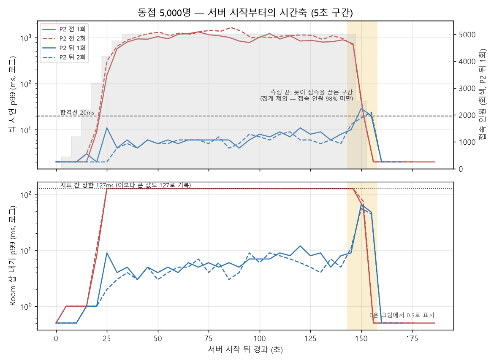

# JH_MMO

AI(Claude Code)와 함께 혼자 만든 MMORPG입니다. **자체 C++ IOCP 게임 서버 + Unreal Engine 5.8 클라이언트**로 이루어져 있습니다.

▶ **시연 영상**: https://youtu.be/bJ_Oc8HYgQE

- 몬스터 전투, 장비·인벤토리, 1:1 거래, 경매장, 파티 던전, 상점 NPC
- 서버·클라이언트·DB·부하 시험 봇·장비/소품 에셋을 1인 제작
- 2026-06 시작, 커밋 220여 개, 설계 결정 기록 `D-311`까지

## 핵심 수치

| 항목 | 결과 |
|---|---|
| 동시 접속 | 봇 **5,000명** 접속 실패 0 |
| 서버 틱 지연 p99 (5,000명) | 938~1,115ms → **6ms** (합격선 20ms) |
| 서버 송신량 (5,000명) | 약 100만 → **18만 메시지/s** (이동 패킷 묶기) |
| 한곳에 100명 밀집, 핑 p99 | 153~161ms → **21~23ms** (세션별 송신 묶기) |

측정 환경과 방법, 한계는 [Docs/BENCHMARK.md](Docs/BENCHMARK.md)에 정리했습니다. 모든 수치는 저장소에 커밋된 원자료(`Server/PerfData/`)에서 다시 뽑았습니다.



## 구조

```
UE 5.8 클라이언트 / 부하 시험 봇
        ⇅  Protobuf 패킷
게임 서버 (C++, IOCP 워커 스레드)
  Listener(AcceptEx) → Session(패킷 조립) → 패킷 핸들러
  → JobQueue(한 번에 한 스레드) → Room(이동 검증·전투·100ms 틱, 상태는 여기서만 변경)
  → 세션별 송신 묶기 → WSASend
  Timer 스레드 · DB 큐(DB 작업 스레드, 결과는 다시 JobQueue로) · 전역 AuctionService
        ⇅  ODBC
SQL Server
```

- **서버 권위**: 위치·스탯·전투 결과·장비·아이템은 서버가 계산하고 클라이언트는 반영만 합니다.
- **아이템 정합**: DB 저장이 성공한 뒤에만 메모리와 화면에 반영합니다. 동시 요청·끊김·DB 실패 시나리오에서 시험 전후 DB의 골드·아이템 합계를 대조해 복사·소실이 없는지 자동으로 판정합니다.
- **데이터 기반**: 스탯·장비·스킬·몬스터·드랍 수치는 `Common/DataTable/*.csv` 하나를 서버와 UE가 함께 읽습니다.

## 폴더

| 경로 | 내용 |
|---|---|
| [`Server/`](Server/) | `ServerCore`(IOCP·세션·JobQueue), `Server`(게임 서버), `BotEngine`·`LoadTest`·`DummyClient`(부하 시험 봇), `NavGenerator`(Recast 내비메시) |
| [`UEClient/JM/`](UEClient/JM/) | UE 5.8 클라이언트 (`JM.uproject`) |
| [`Common/Protocol/`](Common/Protocol/) | `.proto` 원본, 생성 코드는 서버·클라이언트로 복사 |
| [`Common/DataTable/`](Common/DataTable/) | 서버와 UE가 함께 읽는 CSV 데이터 |
| [`Docs/`](Docs/) | 로드맵, 설계 문서, 결정 기록, 시험 기록, 벤치마크 보고서 |
| [`Tools/`](Tools/) | 밸런스 검사, 벤치마크 그래프, 봇 배포, 시연 촬영 도구 |

## AI와 일하는 방식

사람이 항목과 합격 기준을 정하고 결과를 판정하며, AI가 계획·구현·시험·기록을 맡습니다.

- [`CLAUDE.md`](CLAUDE.md) — 모든 AI 세션이 먼저 읽는 작업 규칙 (하위 폴더별 `CLAUDE.md` 포함)
- [`.claude/skills/`](.claude/skills/) — 빌드, 서버 실행, 패킷 생성, 부하 시험, PIE 확인, 장비·맵 제작 같은 반복 절차
- [`Docs/ROADMAP.md`](Docs/ROADMAP.md) — 한 번에 한 항목씩, 완료 기준과 함께
- [`Docs/DECISIONS_CURRENT.md`](Docs/DECISIONS_CURRENT.md) — 지금 유효한 설계 결정 요약 (원본 로그는 [`Docs/DECISIONS.md`](Docs/DECISIONS.md))
- [`Docs/TESTING.md`](Docs/TESTING.md) — 항목별 검증 기록
- `.githooks/` — `.proto`를 고치고 생성 코드를 다시 만들지 않은 커밋을 막는 pre-commit 훅

## 빌드

- **서버**: Visual Studio 2022에서 `Server/Server.sln` 빌드 (x64). DB는 SQL Server(ODBC)가 필요합니다.
- **클라이언트**: `UEClient/JM/JM.uproject` (Unreal Engine 5.8)
- 일부 외부 에셋(Fab 팩)은 용량·라이선스 때문에 저장소에 없습니다. 목록은 [Docs/ExternalAssets.md](Docs/ExternalAssets.md)를 참고하세요.

## 에셋 출처

캐릭터 바디·몬스터·일부 배경 장식·이펙트는 Fab 무료 에셋, 동작은 Mixamo, 던전 텍스처는 Poly Haven(CC0)입니다. 장비·소품·아이콘은 VARCO 3D와 Claude로 제작했습니다.
